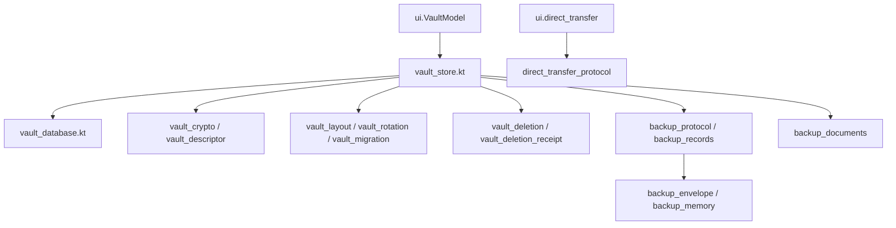
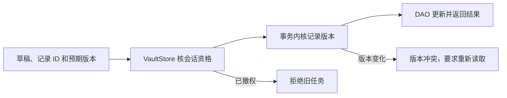

# Android 数据与密码库

本包由 [VaultModel](../ui/vault_model.kt)及相关功能控制器调用。
[VaultStore](vault_store.kt)持有当前库会话和数据库访问资格；Room／SQLCipher、加密、
文件选择结果及库生命周期分别由下列模块承接。

| 文件 | 功能与关系 |
|---|---|
| [vault_store.kt](vault_store.kt) | 当前会话、记录读写、备份预览／提交及库管理入口，串行协调存储操作 |
| [vault_database.kt](vault_database.kt) | Room 实体、DAO、迁移入口及 SQLCipher 数据库创建／打开 |
| [vault_models.kt](vault_models.kt) | 库信息、记录草稿／摘要、检查结果、错误类型及输入校验 |
| [vault_crypto.kt](vault_crypto.kt) | 随机材料、Argon2id 派生与 AES-GCM 密钥封装 |
| [vault_descriptor.kt](vault_descriptor.kt) | 库描述认证、生物绑定附加数据和身份格式校验 |
| [vault_layout.kt](vault_layout.kt) | 数据与描述文件组的选择、解析和发布定位 |
| [vault_rotation.kt](vault_rotation.kt) | 改密及生物绑定变更的准备、发布和清理结果 |
| [vault_migration.kt](vault_migration.kt) | 旧结构迁移、来源版本及恢复材料核验 |
| [vault_biometric.kt](vault_biometric.kt) | Android Keystore 绑定、强生物认证对象及密钥封装 |
| [vault_deletion.kt](vault_deletion.kt) | 删库预览、确认与恢复，结果区分已删除和清理残留 |
| [vault_deletion_receipt.kt](vault_deletion_receipt.kt) | 删库过程的文件身份和恢复回执 |
| [backup_documents.kt](backup_documents.kt) | 系统文档 URI 的读取、写出、身份核验与自有文件清理 |
| [backup_envelope.kt](backup_envelope.kt) | 备份封装解析及本次加密字节的受控保存 |
| [backup_memory.kt](backup_memory.kt) | 备份过程的内存预算 |
| [backup_protocol.kt](backup_protocol.kt) | 可移植备份结构、认证加密、资料校验和内容证明 |
| [backup_records.kt](backup_records.kt) | 当前库快照、字段比较、批量决定、提交计划及事务应用 |
| [backup_store_models.kt](backup_store_models.kt) | 预览、筛选、分页、比较和导入决定的数据类型 |
| [local_backup_record.kt](local_backup_record.kt) | 每库本地备份记录及不可用状态表达 |
| [direct_transfer_protocol.kt](direct_transfer_protocol.kt) | 配对认证、帧、传输结果及回执，供 UI 通道控制器消费 |
| [recovery_codes.kt](recovery_codes.kt) | 恢复码的解析、校验及 JSON 编解码 |
| [totp.kt](totp.kt) | 动态口令密钥归一化、口令和剩余时间 |
| [similar_name.kt](similar_name.kt) | 近名比较所需的统一空白和名称键 |
| [update_check.kt](update_check.kt) | 公开发行信息的查询、筛选和版本比较，不读取密码库 |

## 关系和记录写入

Android 记录以不可变字符串 ID 定位，版本为 `Long`；草稿如 `PasswordDraft` 和预期版本一起提交。
存储层在当前会话内读取记录、核对版本，再在事务中提交，完成后返回记录或明确错误。

当前存储实例一次只持有一个库会话，Mutex 串行协调操作。锁定和切库先改变资格代次，再关闭和清理会话；
取消或旧结果不能凭原对象引用恢复访问。数据库缺失或认证失败不会静默重建空库。

## 备份与库生命周期

备份文件由 `BackupDocuments` 读取，经 `BackupProtocol` 认证和校验后才建立比较预览。
`BackupRecords` 比较来源与当前记录，最终提交重新核验目标并在数据库事务内应用决定。
系统选择器返回 URI 只代表选择完成，不代表解锁或导入完成；取消、切库和撤权会结束对应上下文。

改密、生物绑定和删库通过各自的文件组／回执机制处理。发布成功与旧材料清理成功分别报告，
不能把清理残留改写成业务回滚。详细格式和安全机制分别见
[数据格式](../../../../../../../../../../docs/architecture/data_formats.md)、
[安全与生命周期](../../../../../../../../../../docs/platforms/android/安全与生命周期.md)。

纯逻辑检查位于 [src/test](../../../../../../test)，真实数据库与文件提供方检查位于
[src/androidTest](../../../../../../androidTest)。命令与隔离范围见
[Android 工程说明](../../../../../../../../README.md)。
