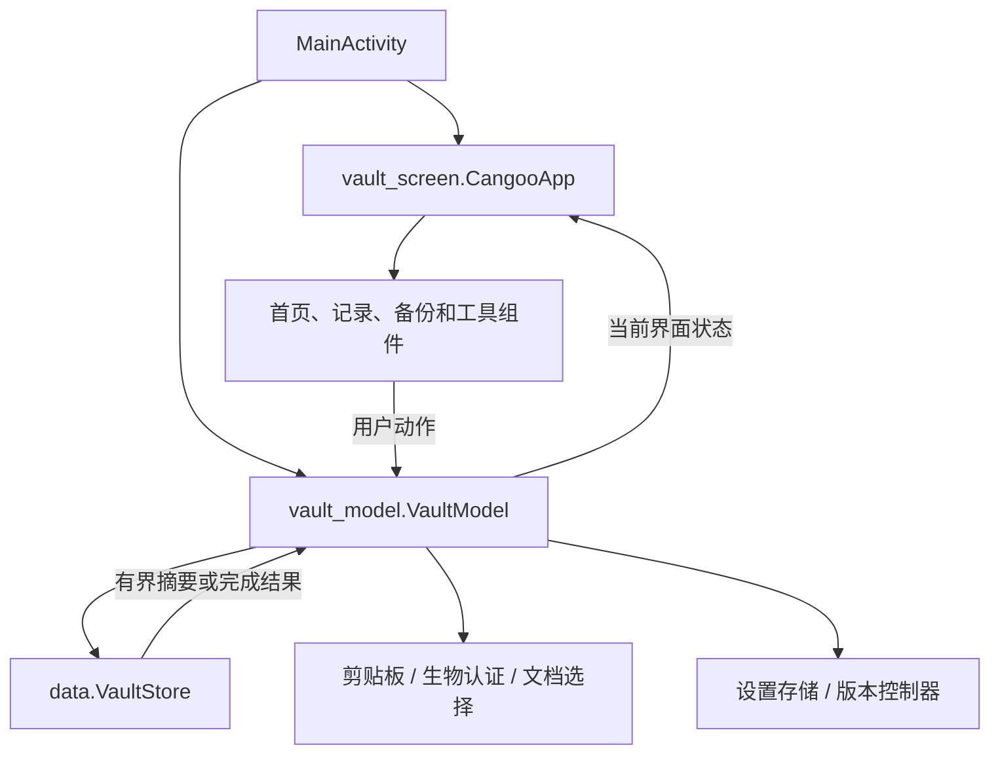
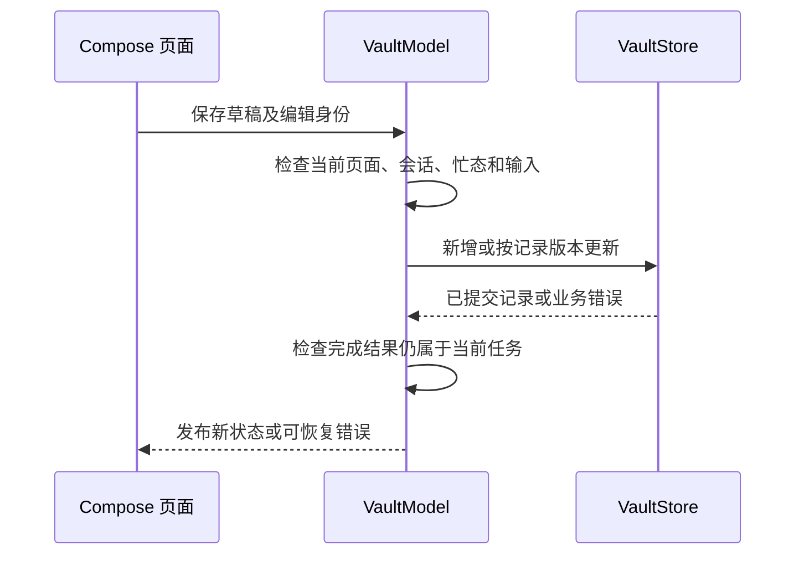

# Android 界面与功能编排

[MainActivity](../main_activity.kt)接收系统事件并创建界面；[vault_screen.kt](vault_screen.kt)中的
CangooApp 组织 Compose 页面，[VaultModel](vault_model.kt)持有当前页面、会话资格和功能任务。
数据库权限与持久化由 [data/VaultStore](../data/vault_store.kt)承担。

| 文件 | 功能与关系 |
|---|---|
| [vault_screen.kt](vault_screen.kt) | 页面路由、列表／详情／编辑及设置界面，把用户动作交给模型 |
| [vault_model.kt](vault_model.kt) | 页面与会话状态、记录操作、任务取消及完成结果发布 |
| [home_components.kt](home_components.kt) | 首页、工具栏、库上下文、底部导航和记录标识组件 |
| [app_icons.kt](app_icons.kt) | 当前应用的矢量图标集合 |
| [appearance.kt](appearance.kt) | 主题、业务字号、配色及外观页 |
| [localization.kt](localization.kt) | 软件语言、结构化文案和局部资源上下文 |
| [ui_preferences_store.kt](ui_preferences_store.kt) | 设备级界面偏好的读取及原子更新 |
| [last_vault_store.kt](last_vault_store.kt) | 最近成功库定位，不保存解锁权限 |
| [session_policy.kt](session_policy.kt) | 安全设置值与空闲期限计算 |
| [security_settings_store.kt](security_settings_store.kt) | 设备级安全设置持久化 |
| [record_secrets.kt](record_secrets.kt) | 密码、TOTP、恢复码的编辑意图、显示状态和组件 |
| [password_tools.kt](password_tools.kt) | 生成参数、校验、随机生成及生成器页面组件 |
| [password_strength.kt](password_strength.kt) | 评分请求、输入／结果边界和服务会话所有者 |
| [password_strength_service.kt](password_strength_service.kt) | 独立评分服务进程与 Binder 通信，调用 Python 桥 |
| [password_strength_page.kt](password_strength_page.kt) | 独立强度检查页面 |
| [backup_flow.kt](backup_flow.kt) | 备份页面、比较、草案及字段读取的界面状态类型 |
| [backup_page.kt](backup_page.kt) | 备份配置、清单、比较和提交确认界面 |
| [export_selection_page.kt](export_selection_page.kt) | 备份与发送共用的自定义资料选择页，按身份保留勾选并显示两类数量 |
| [document_picker.kt](document_picker.kt) | 系统文档选择器请求、结果及原任务关联 |
| [direct_transfer.kt](direct_transfer.kt) | 设备传输状态和任务编排，连接存储快照与通道 |
| [direct_transfer_transport.kt](direct_transfer_transport.kt) | 局域网／经典蓝牙发现、连接和收发 |
| [direct_transfer_page.kt](direct_transfer_page.kt) | 配对、确认、进度和传输操作界面 |
| [clipboard_controller.kt](clipboard_controller.kt) | 当前复制内容的清理责任与生命周期 |
| [clipboard_publisher.kt](clipboard_publisher.kt) | 字段复制资格、系统发布及发布结果 |
| [clipboard_feedback.kt](clipboard_feedback.kt) | 复制操作的短反馈，不承担剪贴板权限 |
| [biometric_prompt_host.kt](biometric_prompt_host.kt) | 当前 Activity 的系统强生物提示和完成回调 |
| [system_access.kt](system_access.kt) | 当前系统能力快照及固定系统设置入口 |
| [system_access_page.kt](system_access_page.kt) | 系统能力和权限说明界面 |
| [system_access_guide_store.kt](system_access_guide_store.kt) | 首次系统设置引导资格与完成记录 |
| [vault_deletion_page.kt](vault_deletion_page.kt) | 删库预览、确认、结果及清理残留提示 |
| [exit_confirmation.kt](exit_confirmation.kt) | 退出确认状态与反馈 |
| [error_messages.kt](error_messages.kt) | 存储及业务错误到结构化界面文案的映射 |
| [basic_edit_menu.kt](basic_edit_menu.kt) | 原生文字菜单转接及取消选择 |
| [note_cursor_visibility.kt](note_cursor_visibility.kt) | 记事编辑光标的可见性协调 |
| [note_position_bar.kt](note_position_bar.kt) | 长记事位置条、滚动位置计算和拖动 |
| [legal_content.kt](legal_content.kt) | 包内许可内容、第三方原文及固定联系入口 |
| [help_page.kt](help_page.kt) | 手册、协议和关于页面 |
| [terms_page.kt](terms_page.kt) | 业务模型创建前的许可告知页 |
| [terms_acceptance_store.kt](terms_acceptance_store.kt) | 当前资料版本的阅读记录 |
| [update_check.kt](update_check.kt) | 版本查询、策略、通知和固定发行页打开 |
| [update_check_store.kt](update_check_store.kt) | 版本策略、忽略及最近结果持久化 |
| [update_check_page.kt](update_check_page.kt) | 版本卡片、详情和间隔设置界面 |

## 界面动作和数据

以保存密码为例，模型捕获当前页面、记录 ID、版本和编辑代次，把 `PasswordDraft` 交给存储层。
存储成功后发布记录和摘要；输入或会话已经变化的完成结果不能覆盖新页面。
无变化保存、版本冲突、失败和用户取消分别沿既有分支处理。

系统锁屏、实际切库和主动锁定由模型收敛任务并调用存储撤权。普通短后台与锁定不是同一状态，
草稿保留和敏感内容清理按[安全与生命周期](../../../../../../../../../../docs/platforms/android/安全与生命周期.md)执行。
会话代次、编辑代次和记录版本各自解决不同问题，不通过拆分控制器复制这些权威状态。

## 评分、系统入口和检查

评分链为 `password_strength.kt` → 独立 `:strength` 服务 →
[strength_bridge.py](../../../../../python/strength_bridge.py) → 构建时复用的 Windows PasswordTools。
结果经输入／任务身份检查后才用于页面或记录评分。

系统选择器、系统设置和生物提示由 Activity 关联当前任务；系统返回不等于获得密码库权限。
UI 偏好和版本策略各有设备级存储，当前库记录仍只由 VaultStore 写入。

纯逻辑检查见 [src/test](../../../../../../test)，界面与服务检查见
[src/androidTest](../../../../../../androidTest)。按功能选择既有检查，运行命令与设备边界见
[Android 工程说明](../../../../../../../../README.md)。B 前缀的现有 Compose 符号表示选定视觉基线，
不是另一套待开发页面；文件名已按当前职责组织。
