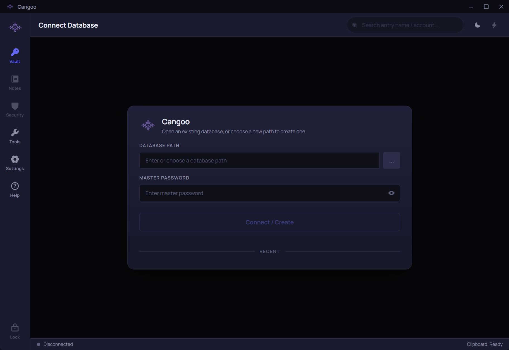
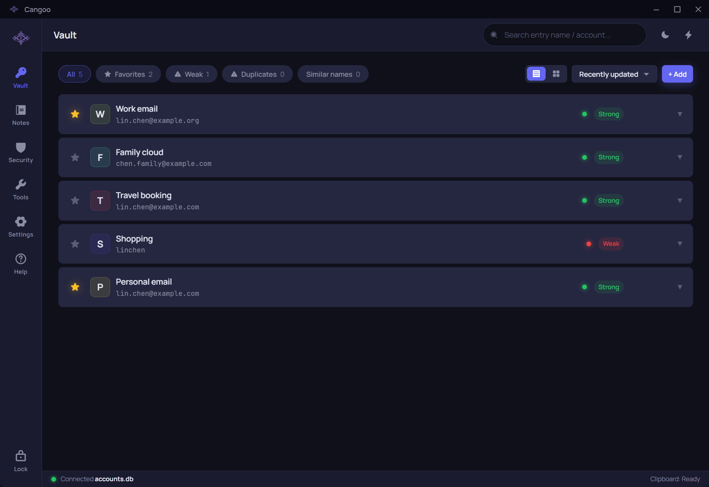
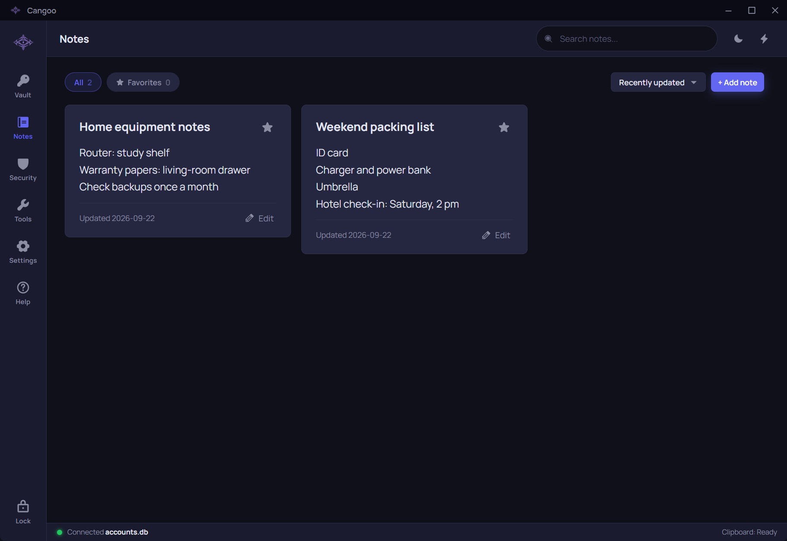
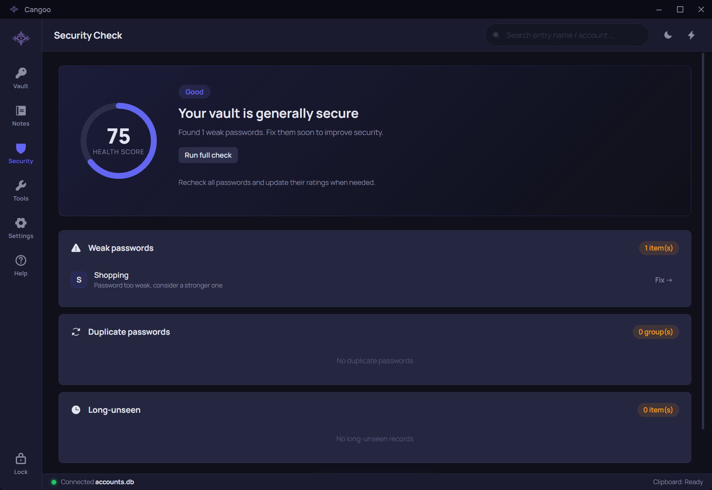
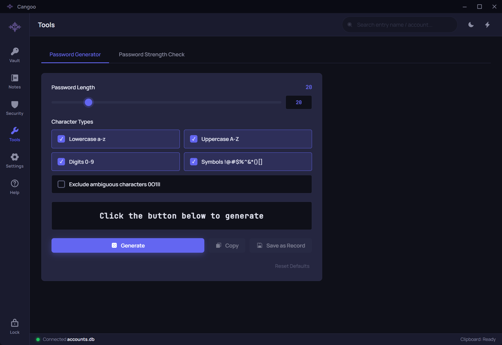
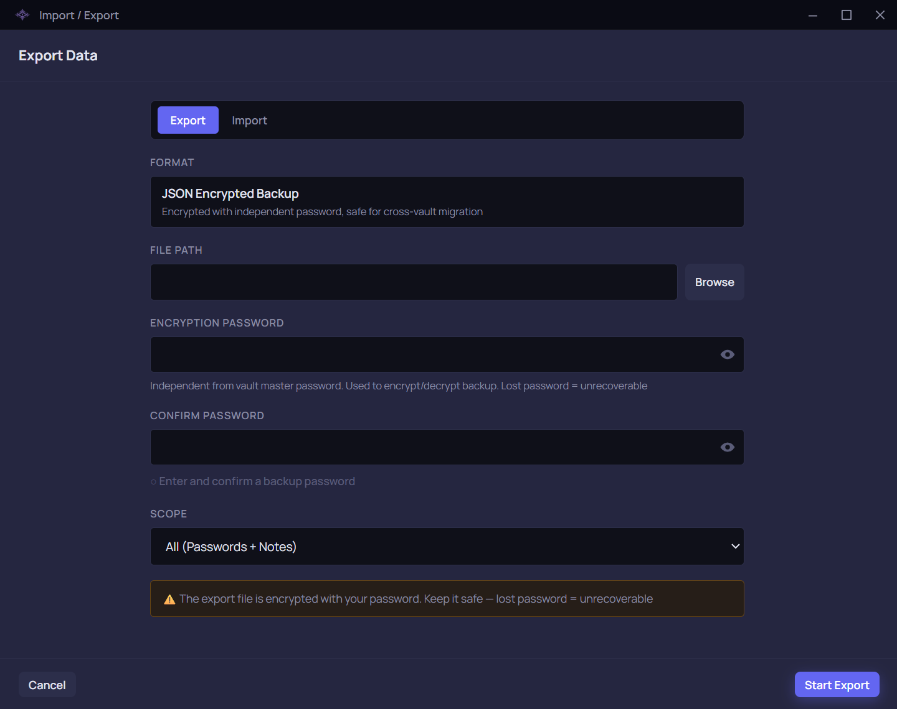

# Cangoo User Guide

## Getting started

<h3>Meet Cangoo</h3>
Cangoo keeps passwords and notes locally. A <strong>database</strong>, also called a vault, is the encrypted file that holds them. You can create separate vaults for personal and work use. Cangoo does not automatically synchronize contents between devices.
<h3>Four steps for your first session</h3><ol><li>Open the app, read the Open-source license and select Continue. You can switch directly between 中文 (Chinese) and English.</li><li>Follow the next chapter to create a vault. Remember its file location and master password.</li><li>Open Vault, add and save a record, then try viewing and copying it.</li><li>Open Settings → Import / Export data and export an encrypted backup. Keep the file and its backup password safe.</li></ol>
Help and password tools work without a database connection. Change appearance, language and text size in Settings. The Windows edition requires a 64-bit computer running Windows 10 version 1809 or later, or Windows 11.
<h3>Three passwords with different jobs</h3><ul><li><strong>Master password:</strong> opens one vault.</li><li><strong>Record password:</strong> belongs to a website or app and is saved in your vault.</li><li><strong>Backup password:</strong> protects an exported backup file and is set separately.</li></ul>
Cangoo has no recovery function for master or backup passwords, so keep each password safe. Store each backup password separately from its file. Periodically test a restore into an empty vault to check that your backup works.
<h3>If you need help</h3>
Read the on-screen message and preserve the original files. Use the contact action under Help → About to describe your app version, steps and error message. Do not send real passwords, databases, backups or screenshots containing sensitive information.

## Create, open and switch vaults

<h3>Create your first vault</h3><ol><li>Check Database path in the connection card. You can use the default location. To choose your own, first prepare a writable folder, then enter the path of a database file that does not exist yet, such as <code>D:\CangooData\personal.db</code>. The <code>CangooData</code> folder must already exist; Cangoo will create <code>personal.db</code>.</li><li>Enter a Master password. Empty master passwords are allowed, but a non-empty, unique, long password is recommended. Keep it safe separately.</li><li>Select Connect / Create. Once the vault opens, you can add records.</li></ol><h3>Open an existing vault</h3>
Select Browse database and choose an existing file, or select a recent item. Enter that vault's master password and connect. Removing a recent item removes only the shortcut, not the file. Startup autofill fills in the last vault's location; it does not unlock the vault.

To switch vaults, first save or discard unfinished edits, select Lock in the sidebar, then choose and connect to another file. Different vaults can have different master passwords.
<h3>If the vault will not open</h3>
For an incorrect password, first check the selected file, capitalization and keyboard input. Three consecutive failures lock that vault for 24 hours; reopening the app does not reset the count. You can try again after the lock period, and a successful connection resets the failure count.

If a browsed or recent file is missing, select the correct file again. Only manually entering a new path creates a new vault. For a damaged or inaccessible file, preserve the original, check that its location is available, or restore a usable backup into a new vault. Do not repeatedly overwrite the original file.

If an older vault needs upgrading, the app first saves an encrypted copy in the same folder, then upgrades the vault. Note the copy name shown after success and keep it safe. Use that pre-upgrade copy if you need the older app.

## Save and use passwords

<h3>Add and save</h3><ol><li>Connect a database, open Vault and select + Add.</li><li>Select or enter a Platform name, such as Example Mail. Enter the Account, password and any notes. The name is required and cannot exactly match another password record in this vault; other fields can be empty.</li><li>You can use the button beside the password to generate a random value. Check the details and select Save. After success, find the record in the list.</li></ol>
Cangoo stores records. Adding or changing a password here does not register an account or change the password on a website or app.
<h3>View, copy and edit</h3>
List and split views show the same records. Use the eye button to show or hide a password. Use the relevant copy button for an account, password or one-time code, then paste into the target app. An empty field or failed copy produces a message; it does not mean copying succeeded.

Open a record's edit action to make changes, then save. Scroll to read long accounts, passwords or notes; select Load full content when offered. If a record has changed elsewhere, preserve any draft you need, then follow the prompt to load and check the latest content.

Before deleting, check the record and keep any backup you need. Confirmed deletion cannot be undone directly.
<h3>One-time codes</h3>
A website or app may provide a setup key when you enable two-step verification. Enter it in One-time password secret, not the current six-digit code. After saving, Cangoo shows changing codes with a countdown. If login fails, first check your computer's time and the account you are using.

The existing setup key is not shown while editing. Leave the field empty to keep it, enter a new key to replace it, or select Remove existing secret to remove it. Replacement or removal takes effect only after you select Save and saving succeeds. These actions change only the Cangoo record; they do not disable two-step verification on the website.
<h3>Recovery codes</h3>
If a service provides recovery codes, save one per line in the record. View and copy individual codes in the details, then mark a code used after the service accepts it. You can undo an accidental mark. Copying does not mark a code used, and an unmarked code is not guaranteed to remain valid at the service.

When editing existing codes, an empty field keeps the set. To replace or remove the entire set, make the change, select Save, then confirm when prompted. After a successful replacement, none of the new codes are marked used. Keep an independent safe copy: you cannot access codes in Cangoo if you cannot open this vault.

## Search, sort and favorites

<h3>Find a record</h3><ol><li>Make sure the correct vault is open.</li><li>Search names or accounts at the top of Vault. In Notes, search a title or part of the body. Vault and Notes keep their own queries.</li><li>Search names, accounts and note titles using the original Chinese text, full pinyin or initials. For example, enter <code>youxiang</code> or <code>yx</code> to find 邮箱. Note bodies match the original text. Password values, authenticator setup keys and recovery codes are not searched.</li><li>Use the clear button at the right of the search field to restore results. Shorten overlong input when prompted; the limit is 128 characters.</li></ol><h3>Filter and sort</h3>
Vault offers all records, favorites, weak passwords, duplicates and similar names; Notes offers all notes and favorites. Combine filters with search and sorting. Weak, duplicate and similar-name categories help you review records; they do not automatically edit or delete them.

Sort by name, recent changes or the other available options; Vault also offers strength sorting. Select a star to add or remove a favorite. A record may move when you change sorting, filtering or its contents. This does not mean it was deleted.
<h3>If nothing appears</h3>
Clear the query and check the active filters, then check the current vault. Search using the new name if you renamed a record. For uncommon Chinese readings, try the original text. If a note has unsaved edits, save or discard the draft as prompted before changing the query. Settings search finds settings; Help does not provide full-text guide search.

## Create and edit notes

<h3>Save a note</h3><ol><li>Connect a database, open Notes and select + Add note.</li><li>Enter a title and body, optionally mark it as a favorite, then select Save. A title is required; different notes can have the same title.</li><li>After success, check the note in the list. For longer content, open its reading action and scroll through the full text.</li></ol><h3>Edit and organize</h3>
Select Edit on a note, change the title or body, then Save. Favorites, search, sorting and paging help you organize notes. Check the title and content before confirming deletion. Back up important notes first; deletion cannot be undone directly.
<h3>Drafts and errors</h3>
Searching, paging or leaving with unsaved edits may prompt you to handle the draft. Choose to keep editing if you need the input. After a save failure, stay on the current page and follow the message to correct or retry. If the note changed elsewhere, check the latest content before saving again.

Locking, switching vaults or quitting ends the current edit. An unsaved draft is not a saved note. Long content may take time to open initially; follow the prompt to load the full content before editing, and do not mistake a partial preview for the complete note.

## Check and improve password security

<h3>Check the current vault</h3><ol><li>Connect a database and open Security to review weak, duplicate and long-unchanged passwords.</li><li>Select Fix or View on an issue. You can also select Fix one by one, then Go to edit or Skip as prompted.</li><li>Change the real password on the website or app first, then save the new password in Cangoo. The guide does not change external accounts for you.</li><li>Return to Security to review the result. Select Run full check when needed.</li></ol><h3>Understand the results</h3>
Pending means a strength result is not available yet. Wait for the check to finish before reading the rating; do not treat Pending as Strong or Weak. A full check shows progress, and you can browse other pages while it runs. Cancel check stops further checks while keeping completed ratings. Follow the on-screen retry action after a failure.

Long-unchanged checks use the last password-change date recorded by Cangoo. Adjust the number of days under Settings → Security → Long-unseen threshold. Editing only a name, account or note does not reset that time. Strength ratings, scores and estimated cracking times are guidance, not security guarantees.
<h3>Continue or end the guide</h3>
Skip an item if you are not ready to address it. Abandoning the guide does not undo changes you have already saved. If records changed or were deleted elsewhere, reopen the current list. Check unfamiliar account changes with the relevant service.

## Generate and check passwords

<h3>Generate a password</h3><ol><li>Open Tools → Password Generator. Set the length and choose lower-case letters, upper-case letters, numbers and special characters. Exclude ambiguous characters if you need easier manual reading.</li><li>Choose a length from 1 to 1024 characters and at least one character type. The length cannot be shorter than the number of selected types. Enter larger lengths directly in the number field. Then select Generate password.</li><li>Check the target website's password rules, then select Copy to use the result. Select the generate button again for another password.</li><li>With a vault connected, select Save as Record, fill in the platform, account and other details, then Save. Generating, copying or opening the editor alone does not save a record.</li></ol>
Reset Defaults restores the generator's default options and generates a new password using them. The generate button in a record editor uses the generator settings; adjust them in Tools first if you need different rules.
<h3>Check a password</h3>
Switch to Password Strength Check and enter the password to assess. You can also enter the platform and account to help identify whether the password contains that guessable information. Review the rating, risks and suggestions. Checks are processed locally without uploading the input. They do not change saved records or website passwords.
<h3>If something goes wrong</h3>
For an empty character selection or invalid length, correct the options and generate again. A failed copy does not mean the clipboard changed. If the generated result has expired, generate a new one. Tools also work without a database connection; locking or quitting clears sensitive results.

## Quick Bar

<h3>Find something in the current vault</h3><ol><li>Turn on Enable Quick Bar in Settings. Open it with the global shortcut, <code>Alt+P</code> by default, or the shortcut at the top of the main window.</li><li>Type a record name or account and select with the up and down arrows. Original text, full pinyin and initials are supported. Only the currently unlocked vault is searched.</li><li>Press <code>Enter</code> to copy the password or <code>Ctrl+Enter</code> to copy the account. You can also use the corresponding buttons, then paste in the target app.</li></ol>
The bar remains open after copying so you can copy another field. If too many results appear, type more characters from the name or account to narrow the list, or use the clear button to enter a new query. If disconnected or locked, return to the main window and open a vault first.
<h3>Generate quickly</h3>
Enter <code>gen</code> for a random 20-character password, or <code>gen 32</code> for 32 characters. Lengths from 4 to 1024 are supported. The password is generated and copied only when you press Enter or select the generate item. Copied appears in place after success; no record is created automatically.
<h3>Close the bar or change its shortcut</h3>
Press <code>Esc</code> to close the bar, or wait for its idle timeout. Adjust Quick Bar idle hide and Quick Bar hotkey in Settings. When changing a hotkey, press the desired combination; Esc cancels. Choose another combination if it conflicts with another app. Hiding the bar does not mean the vault has been locked.

## Encrypted backup and restore

<h3>Export a backup</h3><ol><li>Connect the vault to back up. In Settings → Import / Export data, select Open.</li><li>Select Export, use Browse to choose a destination, then choose everything, passwords only or notes only.</li><li>Set a separate, non-empty backup password and enter it again to confirm. It does not have to match the master password.</li><li>Select Start Export. After success, check that the file was saved and keep its backup password safe separately.</li></ol>
A backup contains the selected password records and notes, including favorites, authenticator setup keys, recovery codes and local used marks. It excludes the master password, app settings and device-bound quick unlock. Choose everything when you need a complete backup; a notes-only backup does not contain your password records.
<h3>Compare before restoring</h3><ol><li>Back up the current vault first. For your first attempt, consider restoring into a new, empty vault.</li><li>Choose Import in the same window, select a Cangoo encrypted backup, enter that file's backup password and select Preview. Allow time for large backups to decrypt and finish checking.</li><li>Review passwords and notes in their separate groups. Empty groups are skipped; moving between groups preserves your choices for this preview.</li><li>Choose overwrite or skip for every Pending item; notes also allow keeping both. Once no items remain pending, check the add, overwrite and skip counts and select Start Import. After the success message, check the results in Vault and Notes.</li></ol>
Choices in the preview are provisional. Records are written only when you confirm the final import. Importing does not change the target vault's master password or delete existing records absent from the backup.
<h3>Compare differences and choose actions</h3>
The current vault is on the left and the backup on the right. All source records appear by default with differences highlighted; identical content is skipped automatically. Passwords, authenticator setup keys and recovery codes are hidden. One click on a field's eye reveals both sides; another hides them. Read long content using the available section or scroll controls.

For same-name password conflicts, overwrite or skip. <strong>Overwrite replaces the whole record, not just changed fields.</strong> Skip keeps the current record. For notes with the same or similar titles, you can also keep both. Explicitly choose a target to overwrite. If one incoming note matches several existing notes, open that item and choose which existing note to overwrite. Bulk overwrite will not choose the target for you.

Use Pending, Different, Skipped and changed-field filters to narrow the list. Select records for bulk overwrite or skip; notes also allow keeping both. Select page chooses eligible items on the current page only. Paging or filtering does not clear earlier selections, so check the selected count and items outside the filter before applying. Automatic additions and identical skipped records do not need selection.
<h3>Cancel, lock and recover from errors</h3>
Canceling or closing the preview does not import anything. Comparison follows normal inactivity locking, and normal interaction resets the timer. After locking, switching vaults or quitting, start a new preview and choose again. Use Back to file and password to change the file or password. For received device contents, return to device transfer and receive a fresh copy.

For a wrong password, damaged file or unsupported format, preserve the original file and check the file and password before retrying. This feature accepts Cangoo encrypted backups; it is not a general importer for other password managers or CSV files.

Restoring an older backup restores recovery codes and local used marks from that time. Check their real status with the service. Old-format backups contain no recovery codes; overwriting a current record with codes clears that set, with a warning in the preview. Skip keeps the current record.

## Transfer between devices

<h3>Prepare both devices</h3>
Device transfer sends one copy of your contents to another device. The receiver compares it and decides what to import. It supports Windows and Android, two Windows computers or two Android phones. Both devices need a version that supports pairing codes.
<ol><li>Unlock the vault to use on each device and open Settings → Device transfer. Choose sending on one and receiving on the other. Vault names can differ.</li><li>Select the same connection method. Local network can use Wi-Fi, Ethernet or a manually enabled phone hotspot. For classic Bluetooth, pair in system settings first and grant connection permission.</li><li>If Windows requests local-network authorization, select Allow local devices to connect and review the system prompt. You can retry after cancelling. Do not disable the firewall or change the network type. Authorization applies to this copy of Cangoo and can be revoked in the same area; communication starts only when you search or wait to receive.</li></ol><h3>Pair and send</h3><ol><li>Start waiting on the receiver. It displays an 8-digit temporary pairing code, valid for 10 minutes until pairing succeeds. Normal vault locking still applies while waiting.</li><li>Find and select the receiver on the sending device. Enter its 8 digits, keeping any leading zeros, and select Pair devices. If the receiver has no pairing code, update both copies of Cangoo first.</li><li>The receiver checks the other device and selects Allow sending once. The displayed device name is only a recognition aid.</li><li>The sender checks both vaults and the direction, chooses everything, passwords only or notes only, and sends. The receiver accepts the contents automatically without another scope confirmation.</li><li>After complete reception and validation, the receiver compares differences and confirms the import as described under Encrypted backup and restore. The sender can leave at this point. Received does not mean written to the vault.</li></ol><h3>Discovery or pairing problems</h3>
For a local network, expand Manual connection and enter an IPv4 address shown on the receiving page, without a port. Once the device replies, enter its pairing code. If several addresses are shown, choose the Wi-Fi or Ethernet address on the same network as the sender. A preferred address is not a guarantee of reachability.

If the code is wrong or pairing does not finish, check that the receiver is still waiting and verify its current code before retrying. After code expiry, receiver rejection, an established connection breaking or either user cancelling, start receiving again with a new code. Cangoo does not reconnect automatically. Listed Bluetooth devices can be offline and must also be waiting inside Cangoo.
<h3>Contents and locking</h3>
Each session transfers one batch; the vaults do not stay synchronized automatically. Sending leaves the source unchanged. Existing receiver records absent from the batch remain. Master passwords, app settings and device bindings are excluded. Existing encrypted backup files can still be moved and imported normally.

Keep both apps in the foreground where possible. Idle auto-lock pauses during actual transfer and complete validation. Android hides contents and tries to continue during a brief background switch; Windows can continue in the tray. Waiting, entering a code and comparing received contents use normal locking rules. Manual locking, switching vaults, quitting, screen lock or sleep still ends the task. Incomplete or invalid contents cannot be imported. The idle timer restarts for the original valid session when the task ends.

## Settings, locking and updates

<h3>Find and adjust settings</h3>
In Settings, search for a name or description such as Clipboard in the top search field. Clear it to show everything. Leaving Settings clears this query without changing your vault or note queries.

Adjust light, dark or automatic theme, Chinese or English, 90%/100%/110%/125% text size, sidebar labels and the default list or split view. Cangoo saves switches and choices automatically when you change them. Finish number entries as directed on screen. If saving fails, follow the message to correct or retry. Vault-related settings that are unavailable while disconnected become usable after unlocking.
<h3>Lock, tray and exit</h3>
Select Lock in the sidebar before leaving your computer; you will need to reconnect afterward. Set inactivity auto-lock and its number of minutes under Security. Computer sleep always locks the vault.

By default, closing the window sends it to the system tray; <strong>this is neither exit nor lock</strong>. Change Close button behavior to exit directly if preferred. Regardless of this setting, use Exit in the tray menu to quit. Hover over the tray icon to read the connection status.
<h3>Clipboard cleanup</h3>
Under Clipboard, choose countdown or manual cleanup and set the countdown duration. After copying, you can also use Clear now in the clipboard status area at the bottom. Cangoo cannot retract system clipboard history, synchronization or copies already read by other apps.

If exit reports a cleanup failure, try again first; choose to exit anyway only after reading the warning. This does not mean the clipboard was cleared. Encryption and locking cannot guarantee safety on a device controlled by malware.
<h3>Change the master password</h3><ol><li>Export and check a backup first.</li><li>In Settings → Database management → Change database password, select Change password.</li><li>Enter the current master password, the new one and its confirmation, then submit as prompted.</li><li>After success, reconnect with the new master password. Existing backups still use their own backup passwords.</li></ol>
On failure, follow the screen's recovery or reconnection guidance and check your data before doing anything else. Do not delete the original file. Changing a master password does not change website passwords.
<h3>Check for app updates</h3>
Select Check now in Settings → Software updates or Help → About. Automatic checks are on by default with a one-day interval. Once the selected number of days (24 hours each) has elapsed since the last attempt, the next app launch checks again. Restoring from the tray does not trigger a check. Failed attempts and manual checks also refresh this time.

Enter a positive whole number of days in Check interval, then press Enter or leave the field to save; there is no separate save button. Turning off Check at startup disables the interval field, but Check now remains available.

Update checks read public release information from GitHub without sending vault contents or the master password. Automatic failures do not open a dialog; manual checks show the result and allow retry. A failure does not mean you are up to date. Open Update details to read the notes. Remind in 7 days and Ignore this version affect only automatic reminders; later versions can still prompt you. You can check manually anytime and use Open release page to decide whether to download and install. Cangoo does not install updates automatically.

## Install, migrate and uninstall

<h3>Installed and portable editions</h3>
Open setup and choose whether to install for yourself or for all users, then choose the location and shortcuts. A current-user installation lets you choose a parent folder and adds one Cangoo folder: D:\Apps becomes D:\Apps\Cangoo; D:\Apps\Cangoo becomes D:\Apps\Cangoo\Cangoo. An all-users installation uses the protected system program directory and requires administrator approval. It does not share vaults between Windows accounts.

Extract the portable edition and keep its entire folder together. Do not copy only its executable or mix new files into an old installation that is still running.

On a shared computer, choose an installation folder that other accounts cannot modify.
<h3>Repair and update</h3>
Save your edits, make an encrypted backup and exit Cangoo from the system tray. Reopen the same version of setup and select Repair on the maintenance page; a newer package offers Update. Both keep the existing installation location and shortcut choices. Repair restores program files, not damaged vaults or deleted records. Open your original vault and check your data afterwards.
<h3>If setup asks you to uninstall the previous version</h3><ol><li>Have the new package, the original old package and a vault backup ready, then exit Cangoo from the system tray.</li><li>Uninstall from Windows Installed apps or the original old package. Leave data cleanup unchecked.</li><li>After uninstall completes, open the new package and choose the scope, location and shortcuts again. You can reuse the old folder if it is empty and meets the installation requirements; otherwise choose another location without deleting unfamiliar files.</li><li>Start Cangoo under your usual Windows account and check the original vault. Changing the installer does not require importing your data again.</li></ol>
If the old uninstall is canceled, fails or requires a restart, resolve that first instead of installing over it. If the new installation fails after the old version was removed, keep your vault and backup, resolve the problem and retry. The old program is not restored automatically. An old version may not read a vault already changed by a newer version; check compatibility and retain your pre-migration backup before returning to it. Subsequent updates use the newer setup package normally.

If setup reports that Cangoo is still running, exit normally before retrying. For permission errors, security prompts or installation failures, check the message and package source and keep your vault and backup. Do not repeatedly delete files or disable security software as a troubleshooting shortcut.
<h3>Move to another device</h3><ol><li>Export an encrypted backup of everything on the original device and keep its password safe. Choose a narrower scope only if that is all you need.</li><li>Install Cangoo on the new device, create a vault and import the backup. You can instead transfer directly using the Transfer between devices chapter.</li><li>Check record counts and important contents, including local recovery-code used marks, before deciding whether to remove the original copies. Choose theme, text size and other settings separately on the new device.</li></ol>
To move the portable edition, exit normally and copy its entire folder. Copy any vaults stored outside that folder separately. Open Cangoo at the new location, select the copied vault and verify it before removing original files.
<h3>Uninstall: data is kept by default</h3>
Uninstall Cangoo from Windows Installed apps, or reopen setup and select Uninstall on its maintenance page. The Your data page appears first, with cleanup unchecked. Select Continue, then confirm whether to uninstall. Canceling either step does not clear data.

If you want cleanup, first check that your backup works, select Clear this account’s default vault, settings and security records, then select Continue and confirm. <strong>Only after successful program removal does cleanup delete the current Windows user’s default vault (pdm.db), settings and local security records. Deletion cannot be undone.</strong> Local security records include recent vault locations, failed-password counts and lock records; other vault files are not changed.

Other vaults, all backups and data belonging to other Windows accounts are retained. If the identity or files cannot be verified reliably, or files are in use, they are retained with an explanation. If cleanup is partial, follow the result shown; deleted data cannot be restored by undoing the uninstall. Read both the program-removal and data-cleanup results. Program uninstalled does not mean all personal files were deleted. The portable edition does not use this uninstall flow; protect any vaults in its folder before deleting the folder.

