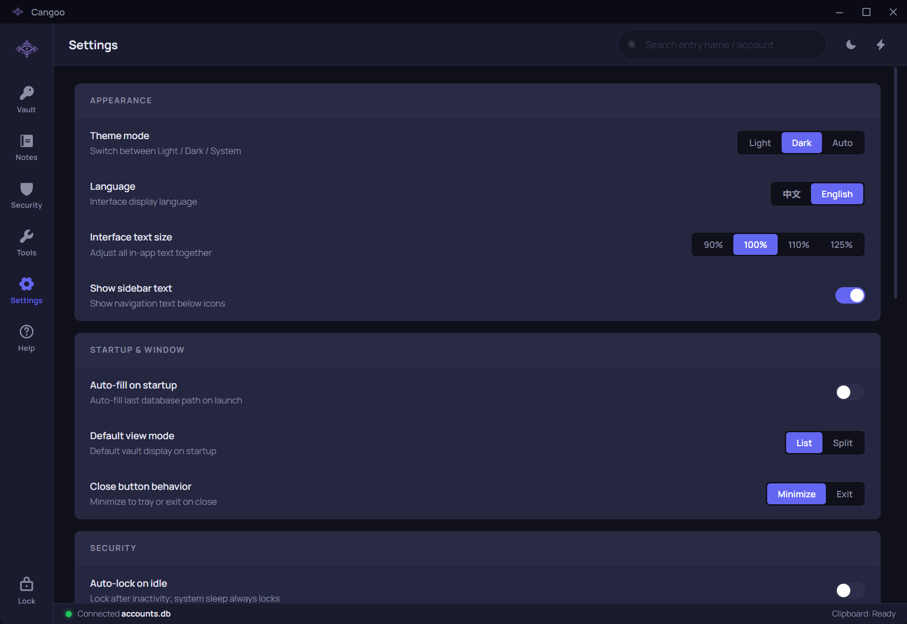

# Cangoo User Guide

## Before you start

<h3>Prepare</h3>
Use a 64-bit Windows 10/11 computer, a writable local folder and a master password you can keep safe. Compatibility depends on the actual Windows version and graphics hardware.
<h3>First launch</h3><ol><li>Read the Software License Agreement. You can switch directly between 中文 (Chinese) and English.</li><li>Select Accept and continue to enter the app. Declining or closing the terms window exits.</li><li>Help is available without a database connection. Use Settings to change theme, language and text size.</li></ol><h3>Understand the three passwords</h3>
A master password opens one database. Record passwords belong to the websites or apps you store. A backup password protects an exported backup. These have different purposes; the app cannot recover forgotten passwords.
<h3>If something goes wrong</h3>
If settings cannot be saved, retry or exit and reopen the app. If the problem persists, describe the error message and your steps in the project community. Find the project address under Help → About or on the download page. Do not submit real passwords, databases or backups.

## Create and open databases

<h3>Create your first database</h3><ol><li>In Database path, enter a local file path that <strong>does not yet exist</strong>, such as D:\CangooData\personal.db. Prepare a writable folder first.</li><li>Enter your chosen Master password. Empty master passwords are allowed, but a non-empty, unique, long password is recommended.</li><li>Select Connect / Create and wait for the result. The vault opens when creation succeeds.</li></ol><h3>Open an existing database</h3>
Use Browse database to select an existing file, or select a recent item, then enter that database's master password. Removing a recent item removes only its shortcut, not the file. Finish or discard unsaved edits, then lock the current database before opening another.
<h3>If something goes wrong</h3>
For an incorrect password, check keyboard layout, capitalization and the selected file. Three consecutive failures lock that database for 24 hours; failures accumulate across restarts and instances. A new three-attempt cycle starts after expiry; successful authentication resets the count. If a browsed or recent file is missing, select it again; manually entering a new path is the creation route. Preserve damaged or unreadable files and check permissions or recover a backup instead of repeatedly overwriting them.

## Manage passwords

<h3>Create and save</h3><ol><li>Connect a database and select + New in Vault.</li><li>In Platform, select or enter a record name (for example, Example Mail); in Account, enter the login name (for example, demo@example.invalid). Fill in the password, notes and optional TOTP secret. The name is required and must be exactly unique in the database; other ordinary fields may be empty. You can generate a password inside the form; verify the destination account before saving.</li><li>Save. The record appears in the list after success. On failure, correct the input or retry as instructed; closing the form is not proof of a successful save.</li></ol><h3>View, copy, edit and delete</h3>
List and split views show the same records. Eye buttons control password visibility. Use the appropriate copy button for the account or password; an empty-field message is not a successful copy. Editing opens a separate window; verify the result after saving. When closing an unsaved edit, choose to keep editing or discard. Confirm the target before deletion; there is no undo, so keep a backup.
<h3>Verification codes</h3>
For time-based one-time passwords (TOTP), enter the secret supplied by the service, not its currently displayed six-digit code. Incorrect system time affects codes; check your clock and secret if sign-in fails.
<h3>Long fields and concurrent changes</h3>
Scroll horizontally to see the end of long accounts and passwords, and scroll long notes. Use the full-content viewer when offered. If another instance changed the same record, load the latest version as prompted and check your edits again.

When editing an existing TOTP record, leaving the secret blank retains the current secret. Use Remove current TOTP and save to remove it. The existing secret is never displayed.

## Search, sort and favorites

<ol><li>The vault search filters names and accounts; Notes searches titles and bodies. Vault and Notes keep separate queries.</li><li>Use the clear button to restore all results. Queries allow up to 128 Unicode characters; shorten an overlong query before searching again.</li><li>Check All, Favorites or another filter, then choose a sort order such as name or recently updated. If nothing appears, clear the query and check active filters.</li><li>Use the star to add or remove a favorite. A record moving after sorting or filtering does not mean it was deleted.</li></ol><h3>If something goes wrong</h3>
Check the connected database. Search for a record's new name after renaming it. Resolve unsaved-note prompts before changing the query. Global search does not become manual search on Help or Settings.

## Create and edit notes

<ol><li>Connect a database, open Notes and select the new-note action.</li><li>Enter a title and body, then save. The card appears after success; expand it to read its body.</li><li>Edit the content and save to write changes to the database. You can favorite, search, sort and page through notes.</li><li>Check the title before confirming deletion. Back up important content first.</li></ol><h3>If something goes wrong</h3>
Unsaved changes may need attention before navigating, searching or leaving. Keep editing preserves your input. On a save error, keep the window open and retry after addressing the message. Locking, exit or security recovery clears visible sensitive content; an unsaved draft is not a persistent record. Read long legacy notes through scrolling or the full-content viewer instead of shortening saved text merely to fit the screen.

## Security review and fixes

<h3>Review and act</h3><ol><li>Connect a database and open Security to inspect weak, duplicate and stale passwords.</li><li>Open a category and review the corresponding records one by one.</li><li>Change the actual password at the website or application, then save it in Cangoo. Editing a stored record does not change the external account.</li><li>Return to the review and rescan when needed to verify the result.</li></ol><h3>Interpret results</h3>
Stale-password checks use the threshold in Settings. Strength and cracking times are model-based estimates. A full review may run in the background; follow its progress. Ordinary navigation does not require restarting the entire task.
<h3>If something goes wrong</h3>
If records changed or were deleted elsewhere, refresh the list. No findings is not security certification. Investigate unexpected account changes with the corresponding service.

## Generate and check passwords

<ol><li>Open Tools and choose password generation. Set the length and character groups, such as lower case, upper case, digits and symbols.</li><li>Lengths range from 1 to 1024; enable at least one character group. Check the destination site's restrictions.</li><li>Copy the result for the intended account. Generating or copying does not save a database record; save one separately.</li><li>Switch to strength checking, enter a password and review its rating, risks and suggestions. A long cracking-time estimate is not a guarantee.</li></ol><h3>If something goes wrong</h3>
Correct out-of-range inputs or an empty character selection as prompted. A failed copy does not mean the system clipboard was updated. Tools work without a database connection, but locking or exiting clears sensitive results.

## Quick Bar

<h3>Find and copy</h3><ol><li>Enable Quick Bar in Settings and use the displayed global shortcut, Alt+P by default.</li><li>Search by record name or account and use arrow keys to select a result. Enter copies the password; Ctrl+Enter copies the account. You can also use the corresponding result buttons.</li><li>If disconnected, return to the main window and connect a database before searching records.</li></ol><h3>Quick generation</h3>
Enter <code>gen</code> for the default 20-character random password or <code>gen 32</code> for 32 characters. The supported range is 4–1024. Enter generates and copies; success shows Copied in place while the bar and input remain open. No record is created automatically.
<h3>If something goes wrong</h3>
If the shortcut does not work, check the feature switch and conflicts with other apps, then record an available combination in Settings. Clear an unsuccessful query and verify the current database. Settings controls automatic hiding; Escape closes the bar manually.

## Encrypted backup and restore

<h3>Export a backup</h3><ol><li>Connect the database you want to back up and find Import / Export data in Settings, then select Open.</li><li>Choose export, the desired scope and destination. Set a <strong>non-empty backup password</strong> and confirm it as requested.</li><li>Select Start Export. After success, verify that the destination file exists. Keep the backup password safe separately.</li></ol><h3>Restore a backup</h3><ol><li>Back up the current database first. Try restoring into a newly created, empty database first.</li><li>Choose import in the same dialog, select a Cangoo encrypted backup and enter that backup's password.</li><li>Select Preview at the bottom of the window, review password conflicts first and note conflicts next. Steps without conflicts are skipped. Bulk buttons affect only the current type. You can go back to passwords without losing note decisions. When all choices are complete, select Start Import once.</li><li>After success, verify the records in Vault and Notes. Canceling, validation failure or merely previewing is not a completed import.</li></ol><h3>Conflicts and errors</h3>
Password-record conflicts between databases use exact original-name matching; accounts only help you identify records. Stop on an incorrect backup password, corruption or an unsupported format or version, preserve the original file and check the file and password. Renaming extensions or editing backup contents does not bypass validation. Import is not a converter for arbitrary CSV, plaintext or other password-manager formats.

Overwrite replaces every field of the matching password record; Skip keeps the target. Notes are checked for exact titles and titles differing only in case or whitespace. Choose Keep both, Skip, or explicitly select an existing target to overwrite. Use Previous target / Next target when several notes match. Two incoming notes cannot overwrite the same target. Overwrite all leaves ambiguous note matches for individual decisions. Keep both for all preserves existing notes and adds a new copy of each incoming note. Encrypted backups contain only the selected password records and notes. App settings and other local app data are not included. To change the file or password, choose Back to file and password, select the file again, enter its password and preview again.

Import / Export opens in a separate window that you can resize or maximize. The preview scrolls independently while bulk actions, the unresolved count, errors and final actions remain visible. Confirm note decisions again after re-previewing a backup that contains notes.

## Settings, locking and exit

Use the top search bar on Settings to filter by setting name, description or group, such as Clipboard. Clear the search to show everything, or try another keyword if nothing matches. The limit is 128 characters; longer input is kept with a warning. Search works without a database connection; existing setting permissions still apply. Leaving Settings clears its search.
<h3>Common settings</h3>
Settings covers light/dark/system theme, Chinese/English, 90/100/110/125 text sizes, sidebar labels, default view, startup path autofill, window-close behavior, automatic locking, clipboard cleanup, Quick Bar and current-database actions. Follow each control's actual range and error messages. A failed settings save is not reported as effective.
<h3>Locking and the tray</h3>
The sidebar lock disconnects the database and clears sensitive displays. Automatic locking and system sleep also trigger their safety handling. By default, closing the window minimizes to the tray; <strong>this is neither exit nor lock</strong>. Use the tray's Exit action to quit. The full white tray icon means connected; the compact outline means disconnected or locked. Hover for the status text.
<h3>Clipboard and exit errors</h3>
Clipboard cleanup follows your selected policy. It cannot retract history, synchronization or copies already read by other apps. If exit reports a clipboard-cleanup failure, retry or explicitly confirm exit after reading the warning. Such an exit does not mean the clipboard was cleared.
<h3>Change the master password</h3>
Back up first, then use the current-database password-change action, enter the required passwords and confirm. After success, open the database with the new master password. Existing backups retain their own backup passwords. On failure, follow the current screen state to reconnect and verify; do not delete the original file based on a guess.

## Migration, updates and uninstall

<h3>Migrate with an encrypted backup</h3><ol><li>Connect the database on the original device. Open Settings → Import / Export data and export the passwords and notes you want to keep. Keep the backup password safe.</li><li>Transfer the encrypted backup to the new device, create a database in Cangoo, then import the backup.</li><li>Verify that your passwords and notes have been restored before deciding whether to remove the original copies.</li></ol>
Encrypted backups migrate passwords and notes. You can choose your preferred theme, text size and other app settings again on the new device.
<h3>Portable edition: copy the entire app folder</h3><ol><li>Exit every app window using the database normally.</li><li>Copy the entire portable app folder to the destination.</li><li>Copy any databases stored outside that folder separately. Open Cangoo, select the database at its new location and connect.</li><li>Check that your records are complete and the app works before removing files from the original location.</li></ol><h3>Updates, uninstall and getting help</h3>
Before updating or uninstalling, make and verify an encrypted backup. Keep your databases and backup files, then follow the release instructions.

If migration fails or you cannot resolve a problem, preserve the original files and ask the community using the project address under Help → About. Describe the app version, your steps and the error message. Do not submit real passwords, databases, backups or screenshots containing sensitive information.

