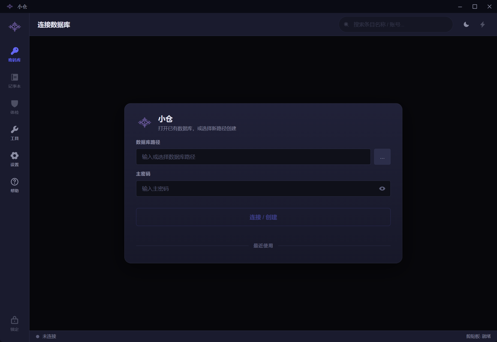
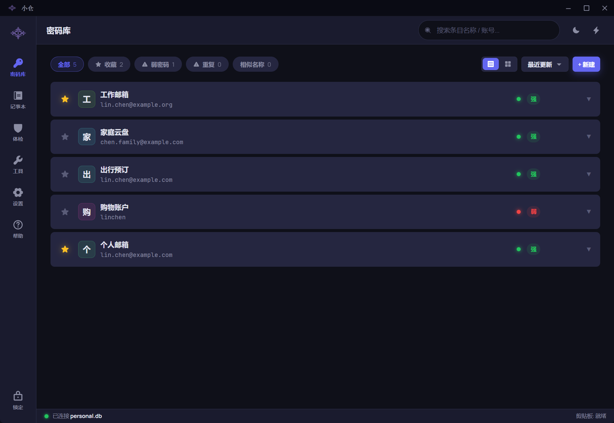
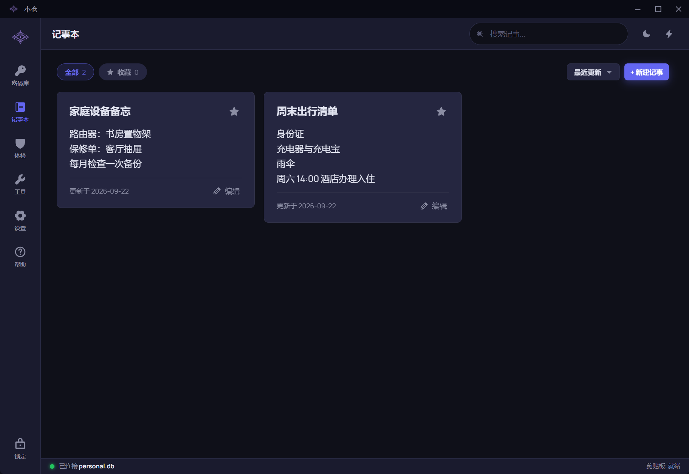
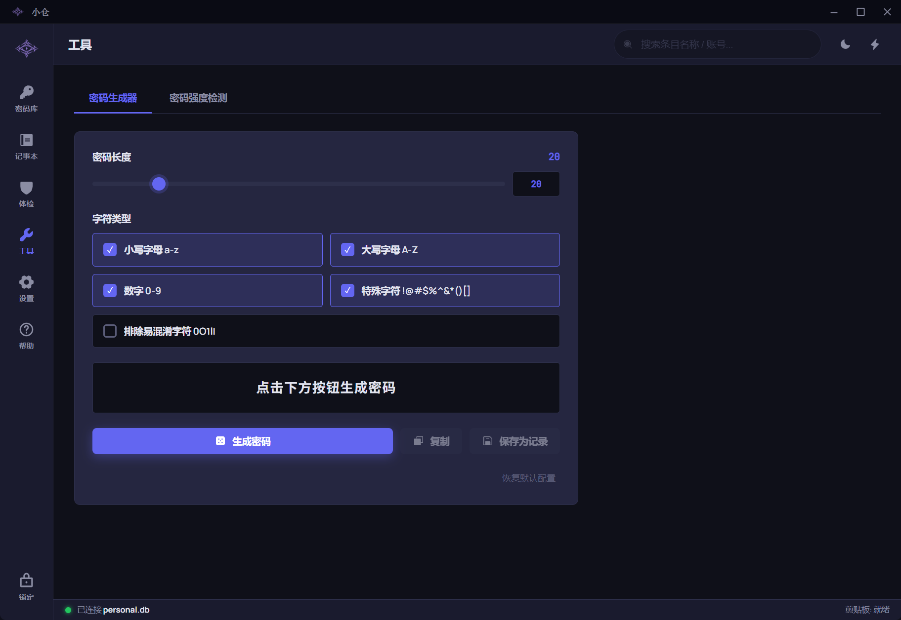
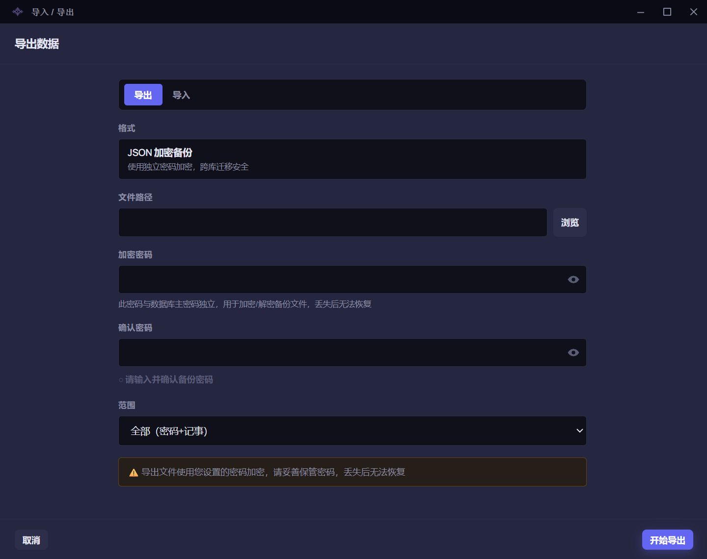

# 小仓使用手册

## 开始使用

<h3>先认识小仓</h3>
小仓把密码和记事保存在本地。<strong>数据库</strong>就是装这些资料的加密文件，也称密码库；你可以建立多个库，分别用于个人或工作。小仓不会自动把资料同步到其他设备。
<h3>第一次使用，按这四步</h3><ol><li>打开软件，阅读“开源许可”，选择“继续使用”。可直接切换中文或 English（英语）。</li><li>按下一章创建一个密码库，记好文件位置和主密码。</li><li>进入“密码库”，新建一条记录并保存；再尝试查看和复制。</li><li>到“设置 → 导入导出数据”导出一次加密备份，妥善保存文件和备份密码。</li></ol>
“帮助”和密码工具在未连接数据库时也能使用；外观、语言和字号可在“设置”调整。Windows 版需要 Windows 10（1809及以上）或 Windows 11 的64位电脑。
<h3>三种密码，不要混淆</h3><ul><li><strong>主密码：</strong>打开一个密码库。</li><li><strong>记录密码：</strong>你保存在库里的各网站或应用密码。</li><li><strong>备份密码：</strong>保护导出的备份文件，由你另行设置。</li></ul>
小仓不提供主密码或备份密码找回功能，请分别妥善保管。请把备份密码与备份文件分开保存，定期在空库中试一次恢复，确认备份可用。
<h3>遇到问题</h3>
先看页面提示并保留原文件。需要求助时，到“帮助 → 关于”打开联系入口，说明软件版本、操作经过和错误提示；不要发送真实密码、数据库、备份或含敏感内容的截图。

## 创建、打开与切换密码库

<h3>创建第一个密码库</h3><ol><li>在连接卡片查看“数据库路径”，可使用页面提供的默认位置。要自行选择位置，先准备一个可写文件夹，再填写其中一个尚不存在的数据库文件路径，例如 <code>D:\CangooData\personal.db</code>。这里的 <code>CangooData</code> 文件夹应已存在，<code>personal.db</code> 则由小仓创建。</li><li>填写“主密码”。软件允许主密码留空，但建议填写一个足够长、只用于这个库的主密码，并妥善保管。</li><li>点击“连接 / 创建”。成功后进入密码库，就可以新建记录。</li></ol><h3>打开已有库</h3>
点击“浏览数据库”选择已有文件，或点击最近使用中的一项，输入该库的主密码后连接。最近项的“移除”只移除这个快捷入口，不删除文件。“启动时自动填充”只帮你填入上次库的位置，不会自动解锁。

切换到另一个库前，先保存或放弃未保存的编辑，点击侧栏“锁定”，再选择另一个文件并连接。不同库可以使用不同的主密码。
<h3>打不开时</h3>
密码不正确时，先核对选中的文件、大小写和键盘输入。连续三次错误会锁定该库24小时；重新打开软件不会重置次数。锁期结束后可重新尝试，成功打开后错误次数清零。

最近使用或浏览选中的文件不存在时，请重新选文件；只有手动填写一个新路径才会创建新库。文件损坏或无法访问时先保留原文件，检查存放位置是否可用，或从可用备份恢复到新库，不要反复覆盖原文件。

旧库若需要升级，软件会先在同一文件夹保存一份升级前的加密副本，再升级。成功后留意副本文件名并妥善保留；需要用旧版软件时，应使用这份升级前副本。

## 保存与使用密码

<h3>新建与保存</h3><ol><li>连接数据库，在“密码库”点击“+ 新建”。</li><li>在“平台”选择或填写名称，例如“示例邮箱”；在“账号”填写登录名，再填写密码和备注。名称必填，不能与本库另一条密码记录完全相同；其他字段可以留空。</li><li>可点击密码旁的生成按钮填入随机密码。核对后点击“保存”，看到成功提示再回列表查找。</li></ol>
小仓只保存记录。新建或修改这里的密码，不会替你注册账号或更改网站、应用上的密码。
<h3>查看、复制和编辑</h3>
列表和分屏显示同一批记录，按自己习惯切换。用眼睛按钮查看或隐藏密码，用对应复制按钮复制账号、密码或动态验证码，再到目标应用粘贴。空字段或复制失败会提示，不要把它当作复制成功。

点击记录的编辑入口修改，保存后才生效。长账号、密码或备注可滚动查看；出现“读取完整内容”时，点击后再看全文。若提示记录已在别处更改，先保留需要的草稿，再按提示加载最新内容并核对。

删除前请核对记录并保留需要的备份；确认删除后不能直接撤销。
<h3>动态验证码</h3>
网站或应用启用两步验证后，可能提供“设置密钥”。把它填入“动态验证码密钥”，不要填当前的六位验证码。保存后，小仓会显示随时间变化的验证码和倒计时。登录失败时，先核对电脑时间与所用账号。

编辑已有记录时，原密钥不会显示。保留原密钥就让输入框留空；要替换则填入新密钥，要移除则点击“移除现有密钥”。点击“保存”并保存成功后，替换或移除才生效。这些操作只改变小仓记录，不会关闭网站的两步验证。
<h3>恢复码</h3>
若服务提供恢复码，可在记录中每行保存一条。详情里按需查看、逐条复制，并在服务确认使用后手动标记已用；误标可撤销。复制不会自动标记，未标记也不保证服务端仍接受。

编辑已有恢复码时，留空会保留原组。要替换或移除整组，修改后点击“保存”，再按弹窗确认。替换成功后，新组的恢复码均未标记为已用。请另留一份独立安全副本：本库打不开时，这里的恢复码也无法取用。

## 搜索、排序与收藏

<h3>找到一条资料</h3><ol><li>先确认已打开正确的密码库。</li><li>在密码库顶部输入名称或账号；在记事本中输入标题或正文片段。密码库和记事本分别保留自己的查询。</li><li>名称、账号和记事标题可按中文原文、拼音全拼或首字母查找，例如“邮箱”可输入 <code>youxiang</code> 或 <code>yx</code>。记事正文按原文查找。密码、动态验证码密钥和恢复码不参与搜索。</li><li>点击搜索框右侧的清空按钮恢复结果。输入过长时按提示缩短，最多128个字符。</li></ol><h3>筛选与排序</h3>
密码库可按全部、收藏、弱密码、重复或相似名称筛选；记事本有全部和收藏。筛选可以配合搜索和排序使用。弱密码、重复、相似名称只是帮助检查的分类，不会自动删改记录。

选择名称、最近更新等排序；密码库还可按强度排序。点击星标加入或取消收藏。更换排序、筛选或修改资料后，条目可能换位置，不表示被删除。
<h3>没有结果时</h3>
清空搜索并检查筛选条件，再核对当前库。名称改过后用新名称查询；少见汉字读音可改用原文。若记事有未保存修改，先按提示保存或放弃草稿再改变查询。设置页的搜索用于找设置，帮助页不提供手册全文搜索。

## 新建与编辑记事

<h3>保存一篇记事</h3><ol><li>连接数据库，进入“记事本”，点击“+ 新建记事”。</li><li>填写标题和正文，需要时设置收藏，再点击“保存”。标题不能为空；不同记事可以同名。</li><li>保存成功后回列表查看。内容较长时，点击阅读入口并滚动查看全文。</li></ol><h3>修改与整理</h3>
点击记事的“编辑”，修改标题或正文后点击“保存”。收藏、搜索、排序和翻页可以帮助整理。删除前核对标题与内容并确认；重要记事应先备份，删除后不能直接撤销。
<h3>草稿与失败提示</h3>
有未保存修改时，搜索、翻页或离开可能要求先处理草稿；不想丢失输入时选择继续编辑。保存失败后先留在当前页面，按提示修改或重试。若提示记事已在别处更改，核对最新内容后再保存。

锁定、切库或退出会结束当前编辑，未保存草稿不等于已保存的记事。长内容首次打开可能需要等待；按页面提示读取完整内容后再编辑，不要把部分预览当作全文。

## 检查与改善密码安全

<h3>检查当前密码库</h3><ol><li>连接数据库后进入“体检”，查看弱密码、重复密码和长期未更换项目。</li><li>点击问题中的“修复”或“查看”，核对对应记录；也可用“逐个引导修复”，按提示“前往编辑”或“跳过此项”。</li><li>先到网站或应用更换真实密码，再把新密码保存到小仓。引导不会自动替你修改外部账号。</li><li>回到体检查看结果，需要时点击“重新全量体检”。</li></ol><h3>如何理解结果</h3>
“待检测”表示尚未得到强度结果，请等检查完成后再看评级；不能把它当作“强”或“弱”。全量体检显示进度，期间可以浏览其他页面；点击“取消体检”会停止后续检查，已经完成的评级仍保留。失败后可按页面提示重试。

“长期未更换”按小仓记录的上次密码更换时间判断。可在“设置 → 安全 → 长期未更换阈值”调整天数；仅修改名称、账号或备注，不会重置这段时间。强度、分数和预计破解时间仅供参考，不是安全保证。
<h3>继续或结束引导</h3>
暂时不处理可跳过，之后继续核对；放弃引导不会撤销你已经保存的修改。记录被其他操作修改或删除时，重新打开最新列表。发现自己不认识的账号变更时，应到对应服务核查。

## 生成密码与强度检测

<h3>生成一个密码</h3><ol><li>进入“工具 → 密码生成器”，设置长度及大小写字母、数字、特殊字符。可勾选“排除易混淆字符”，便于手动辨认。</li><li>密码长度支持1–1024位，至少选择一种字符类型；长度不能少于所选类型数。较大长度可在数字框直接输入。设置好后点击“生成密码”。</li><li>核对目标网站的密码规则，再点击“复制”使用。需要重新生成时，再点一次生成按钮。</li><li>已连接密码库时，可点击“保存为记录”，补全平台、账号等信息，再点击“保存”。仅生成、复制或打开编辑窗都不等于已保存。</li></ol>
点击“恢复默认配置”会恢复生成器的默认选项，并按这些选项生成一个新密码。记录编辑窗口中的生成按钮沿用生成器参数；需要不同规则时先到工具页调整。
<h3>检查一个密码</h3>
切换到“密码强度检测”，输入要评估的密码。还可填写平台名和账号，帮助识别密码是否包含这些容易被猜到的信息。查看评级、风险与建议；输入在本机处理，不会因强度检测上传。检测不会修改已保存记录或网站密码。
<h3>遇到错误</h3>
字符类型为空或长度不合要求时，按提示调整后再生成。复制失败不要当成剪贴板已更新；提示生成结果已过期时，请重新生成。工具在未连接数据库时也能使用，锁定或退出会清除敏感结果。

## 快速搜索条

<h3>随时查找当前库</h3><ol><li>在“设置”中开启“启用 Quick Bar”（快速搜索条）。用全局快捷键唤出，默认 <code>Alt+P</code>；也可用主窗口顶部的快捷入口。</li><li>输入条目名称或账号，按上下方向键选择。支持原文、拼音全拼或首字母；只搜索当前已解锁的库。</li><li>按 <code>Enter</code>（回车）复制密码，<code>Ctrl+Enter</code>复制账号；也可点对应按钮，再到目标应用粘贴。</li></ol>
复制后搜索条保持打开，方便继续复制另一个字段。结果过多时，可多输入几个名称或账号中的字符来缩小范围；点击清空按钮可重新输入。未连接或已锁定时，请先回主窗口打开密码库。
<h3>快速生成</h3>
输入 <code>gen</code>可生成默认20位随机密码；输入 <code>gen 32</code>可指定32位，支持4–1024位。按回车或点击生成项后才会生成并复制。成功后原位显示“已复制”，不会自动创建记录。
<h3>关闭与快捷键</h3>
按 <code>Esc</code>关闭搜索条，或等待其空闲时间结束。可在设置中调整“Quick Bar 空闲隐藏”和“Quick Bar 热键”；修改热键时按所需组合键，按Esc取消。快捷键冲突时换一个组合。搜索条自动隐藏不等于密码库已经锁定。

## 加密备份与恢复

<h3>导出备份</h3><ol><li>连接要备份的库，进入“设置 → 导入导出数据”，点击“打开”。</li><li>选择“导出”，用“浏览”选择保存位置，并选择全部、仅密码或仅记事。</li><li>另设一个非空的备份密码，再输入一次确认；它不必与主密码相同。</li><li>点击“开始导出”。看到成功提示后核对文件已经保存，把备份密码另行妥善保管。</li></ol>
备份含所选密码记录和记事，包括收藏、动态验证码密钥、恢复码及本地已用标记；不包含主密码、软件设置或设备快捷解锁绑定。请按需要导出“全部”，不要把只含记事的备份当作全库备份。
<h3>恢复前先比较</h3><ol><li>先备份当前库。初次尝试时，可创建一个空库来恢复。</li><li>在同一入口选择“导入”，选择小仓加密备份，输入该文件的备份密码，点击“预览”。内容较多时请等待解密和检查完成。</li><li>按密码、记事两组核对。没有资料的组会跳过；两组往返保留本次选择。</li><li>为每条“待处理”资料选择覆盖或跳过；记事也可选择保留两份。没有待处理项后，核对新增、覆盖、跳过数量，再点击“开始导入”。看到成功提示后，回密码库和记事本查看结果。</li></ol>
预览里的选择只是本次决定，最后确认导入才会写入。导入不会改变目标库主密码，也不会删除备份里没有的现有记录。
<h3>怎么看差异、怎样选择</h3>
左侧是当前库，右侧是备份资料。默认列出全部来源记录并突出差异；内容相同的自动跳过。密码、动态验证码密钥和恢复码默认隐藏，点一次同一字段的眼睛即可同时查看两侧，再点一次隐藏。长内容按页面提供的翻段或滚动操作阅读。

密码同名冲突可覆盖或跳过。<strong>覆盖会替换整条记录，不是只改有差异的字段</strong>；跳过保留当前记录。记事遇到同名或相近标题时，还可保留两份；覆盖时须明确选择目标。若一篇导入记事对应多篇现有记事，请点开该项，明确选择要覆盖哪一篇；批量覆盖不会替你选择目标。

用“待处理”“有差异”“已跳过”及变化字段筛选缩小范围。勾选后可批量覆盖或跳过，记事还可批量保留两份。“选中本页”只选当前页可处理项；翻页、筛选不清除此前勾选，应用前请核对选中数量及筛选外项目。自动新增和相同跳过项不需勾选。
<h3>取消、锁定与错误</h3>
取消或关闭预览不会导入。比较期间按正常无操作锁定设置计时，正常操作会刷新计时；锁定、切库或退出后，需要重新预览和选择。想换文件或密码时，用“返回文件与密码”。设备传输收到的资料则返回设备传输重新接收。

密码错误、文件损坏或格式不支持时，保留原文件，核对文件和密码后再试。这里支持小仓加密备份，不是其他密码管理器或CSV文件的通用导入工具。

恢复旧备份会恢复当时的恢复码及本地已用标记，请向对应服务核对真实状态。旧版备份不含恢复码；若覆盖当前含码记录，会清空整组，预览会提示。选择跳过可保留当前记录。

## 设备之间传输资料

<h3>先准备两端</h3>
设备传输把一端的资料副本交给另一端，由接收端比较后导入；不是自动双向同步。支持Windows电脑与安卓手机、两台电脑或两部安卓手机。两端分别解锁本次要用的密码库，库名可以不同。
<ol><li>进入两端的“设置 → 设备传输”，确定哪端发送、哪端接收。</li><li>两端选择同一种连接方式：同一局域网，或蓝牙。局域网可用同一Wi-Fi、有线网络或手动开启的手机热点；蓝牙先在系统设置中完成配对。</li><li>使用局域网的Windows端如显示未授权，先按下段完成授权。</li><li><strong>接收端先开始等待：</strong>电脑版选择“接收资料”并点击“等待发送方”；安卓选择“接收资料”并点击“开始等待接收”。只停在入口还不能接收。</li><li>发送端点击“查找附近设备”（安卓为“查找接收设备”），再选择对方。</li></ol><h3>Windows局域网授权</h3>
点击“允许本地设备连接”，核对并确认Windows提示。小仓平时以普通权限运行，授权和撤销时才需要系统确认。取消授权可留在原页稍后重试，不必手工关闭防火墙或把网络改成专用网络。

授权只用于此份小仓的本地连接；有授权也不表示日常持续等待连接，通信仅在你操作设备传输时启动。不再需要时，可回传输入口点击“撤销局域网授权”，按系统提示确认。用户或组织的其他阻止规则仍可能限制连接。
<h3>找不到设备时</h3>
先确认接收端仍在等待、两端使用同一网络或已完成蓝牙配对，再重新查找。蓝牙列表里能看到设备，不代表对方已经开始接收。

局域网还可展开“未找到设备？输入地址连接”。在接收端等待页查看地址，发送端只填写这个地址，不加端口，点击“连接”。有多个地址时，优先选与发送端连接同一网络的Wi-Fi或有线网络地址；“其他网络地址”不保证可用。安卓对应入口为“手动连接”。网络不允许设备互访时，可改用蓝牙。
<h3>核对后发送</h3><ol><li>逐组比较两端的三组数字；完全相同才分别确认。不一致就取消，不能只凭设备名称判断。</li><li>核对两端的库及发送方向。发送端选择全部、仅密码或仅记事，再点击“确认范围”（安卓为“准备资料”）。</li><li>接收端核对资料后点击“同意接收”（安卓为“接受本次接收”）。对方同意后，发送端再点击“开始传输”（安卓为“开始发送”）。</li><li>等待接收端完整收齐并检查通过。显示“对方已完整接收”后，发送端可以离开；接收端按“加密备份与恢复”章的比较方法选择，最后确认导入。</li></ol>
发送端记录不变；接收端已有但来源没有的记录保留。主密码、软件设置和设备绑定不传输。收到资料不等于已经导入。
<h3>等待、锁定和中断</h3>
传输期间请尽量保持两端在前台。实际传输和完整校验期间暂停软件自动锁库，手机短暂切走会遮蔽内容并尽力继续，电脑版收进托盘也可继续。等待连接及接收后的比较阶段仍按正常锁库规则处理。

主动锁库、切库、退出、系统锁屏或睡眠会结束本次传输。取消、断线或超时后重新开始并重新核对数字，不会自动续传；未收齐的资料不能进入导入。结束后自动锁库重新计时。连接失败时，先让接收端重新开始等待，再由发送端重试。

## 设置、锁定与软件更新

<h3>找到并调整设置</h3>
在“设置”页的顶部搜索框输入名称或说明，例如“剪贴板”，可快速找到相关选项；清空恢复全部。离开设置后此查询会清空，不影响密码库和记事的查询。

可调整主题（浅色、深色、自动）、中英文、90%/100%/110%/125%字号、侧栏文字及默认列表/分屏视图。切换开关或选择选项后，小仓会自动保存。数字输入按页面提示完成。保存失败时会提示，请修正或重试。未连接时不可用的库相关选项，在解锁后即可使用。
<h3>锁定、托盘和退出</h3>
离开电脑前可点击侧栏“锁定”，之后需重新连接。可在“安全”中设置“超时自动锁定”及分钟数；电脑睡眠始终会锁库。

默认点击窗口关闭按钮会缩到系统托盘，<strong>不等于退出或锁定</strong>。可在“关闭按钮行为”选择直接退出；无论该项如何设置，都能通过托盘菜单“退出”结束软件。托盘悬停文字可查看连接状态。
<h3>剪贴板清理</h3>
“剪贴板”中可选倒计时或手动清空，并设置倒计时时长。复制后也可在底部剪贴板状态处使用“立即清空”。系统剪贴板历史、同步和其他应用已经读取的副本无法由小仓收回。

退出时若提示剪贴板清理失败，可先重试；只有了解提示后才选择仍然退出。这不代表剪贴板已经清空。设备受到恶意软件控制时，软件加密和锁定不能保证资料安全。
<h3>修改主密码</h3><ol><li>先导出并核对备份。</li><li>在“设置 → 数据库管理 → 修改数据库密码”点击“修改密码”。</li><li>填写当前主密码、新主密码并再次确认，按提示提交。</li><li>成功后使用新主密码重新连接；原备份仍使用各自的备份密码。</li></ol>
更改失败时按屏幕提示恢复或重新连接，先核对资料，不要删除原文件。主密码更改不会替你修改各网站的密码。
<h3>检查软件更新</h3>
在“设置 → 软件更新”或“帮助 → 关于”点击“立即检查”。自动检查默认开启、间隔1天；距上次尝试满设定天数（每天24小时）后，只在下一次启动时查询，托盘恢复不会触发。失败的尝试和手动检查也会刷新这个时间。

在“检查间隔”输入正整数天数，按回车或离开输入框即保存，不用另点保存。关闭“启动时检查更新”后，间隔变灰；“立即检查”仍可使用。

版本检查会从GitHub读取公开发行信息，不发送密码库内容或主密码。自动失败不弹窗，手动检查会显示结果并可重试；失败不等于已经是最新版。展开“更新详情”可看说明，选择“7 天后提醒”或“此版本不再提醒”只影响自动提醒，更高版本仍可提示。你可随时手动查看，再由“查看发行页”决定下载和安装；小仓不会自动安装更新。

## 安装、迁移与卸载

<h3>安装版与便携版</h3>
安装版适合在这台电脑长期使用：打开安装包，按向导安装。默认“仅供当前用户使用”；需要更改安装位置、使用范围或桌面快捷方式时，进入“选项”。“供这台电脑上的所有用户使用”需要相应系统权限，不会让不同账号共用一个密码库。

便携版解压后即可运行，应保留整个软件目录。不要只复制里面的程序文件，或把新文件混放到正在运行的旧目录。
<h3>修复与更新</h3>
先保存编辑并制作加密备份，再从托盘正常退出小仓。再次打开同版本安装包可进入“修复或卸载”；“修复”用于恢复程序文件，不会替你修复损坏的密码库或恢复已删除的记录。更新时使用新版安装包并阅读发行说明；完成后打开原库核对资料。

安装提示程序仍在使用时，先正常退出再重试。若有权限、系统安全提示或安装失败，先核对提示和安装包来源，保留原库与备份，不必通过关闭安全软件或反复删除文件来尝试。
<h3>迁移到另一台设备</h3><ol><li>在原设备导出“全部”加密备份，妥善保管备份密码；只需要部分资料时再选择对应范围。</li><li>在新设备安装小仓、创建密码库，再导入备份。也可按“设备之间传输资料”章当面传输。</li><li>核对记录数量和重要内容，包括恢复码的本地已用标记，再决定是否清理原设备副本。新设备的主题、字号等设置另行选择。</li></ol>
搬移便携版时，正常退出后复制整个软件目录；放在目录外的密码库还需单独复制。到新位置打开小仓并选中复制后的库，核对无误后再处理原文件。
<h3>卸载：默认保留资料</h3>
可从Windows已安装应用列表卸载小仓，或重新打开安装包，进入“修复或卸载”。默认不勾清理，点击“卸载”只移除程序、保留资料，便于以后重新安装后继续使用。

确实要清理时，先确认备份可用，再勾选清除资料，并点击“卸载并清除所选资料”。<strong>只有程序成功卸载后，才会清除当前Windows用户的默认库（pdm.db）、设置和本机安全记录。清除后无法撤销。</strong>本机安全记录包括最近使用的库位置、密码错误次数和锁定记录；其他库文件不会因此改变。

其他密码库、所有备份及其他Windows账号的资料都会保留。身份或文件无法可靠确认、资料被占用等情况下会保留并提示；若只清理了一部分，以结果提示为准，已清除的内容不能撤销。请同时查看程序卸载和资料处理结果，不要把“程序已卸载”理解为所有个人文件都已删除。便携版不使用安装版卸载流程，删除它的整个目录前，先保护其中的密码库。

